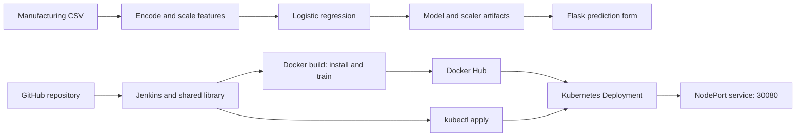

# Jenkins Manufacturing MLOps

A learning project that combines a manufacturing-efficiency classifier with a Jenkins CI/CD workflow. A Flask form accepts machine-operation measurements and returns **High**, **Low**, or **Medium** efficiency. Jenkins shared-library steps check out the source, build and push a Docker image, install `kubectl`, and apply Kubernetes manifests.

## Features

- Preprocess a manufacturing dataset, encode categories, extract timestamp fields, and standardize 14 input features.
- Train a scikit-learn logistic-regression classifier and log accuracy, weighted precision, recall, and F1.
- Serve predictions through a Flask HTML form.
- Build the model inside the Docker image so a fresh checkout does not depend on committed pickle files.
- Reuse Jenkins steps from `vars/` for checkout, Docker Hub publishing, and Kubernetes deployment.
- Include an exploratory notebook and Deployment/NodePort Service examples.

## Technology stack

Python (the image uses 3.11), Flask, pandas, NumPy, scikit-learn, Joblib, Matplotlib, Seaborn, Docker, Jenkins Pipeline/Groovy, and Kubernetes. Python dependencies are listed in [requirements.txt](requirements.txt); they are not version-pinned.

## Architecture



Training runs locally on demand or during the Docker build. The Jenkinsfile does not provide a separate testing or model-validation stage.

## Installation and local execution

Run these commands from the repository root. Use Python 3.11 to match the image; the publication checks used the available Python 3.12 interpreter.

```bash
git clone https://github.com/Puneeth0106/Jenkins-Manufacturing-MLOps.git
cd Jenkins-Manufacturing-MLOps
python3.11 -m venv .venv
source .venv/bin/activate
python -m pip install --upgrade pip
python -m pip install -e .
python -m pipeline.training_pipeline
python application.py
```

On Windows, create the environment with `py -3.11 -m venv .venv` and activate it with `.venv\Scripts\Activate.ps1` in PowerShell.

Open `http://localhost:5000`. Training reads [artifacts/raw/data.csv](artifacts/raw/data.csv), which contains 100,000 rows, and writes:

- `artifacts/processed/`: train/test arrays, labels, and `scaler.pkl`.
- `artifacts/models/model.pkl`: fitted classifier.
- `logs/`: preprocessing, training, and evaluation messages.

Generated files are ignored by Git. The application loads the model and scaler at import time, so training must finish before starting Flask. Run from the repository root because paths are relative to the working directory. Only load Joblib artifacts from a trusted source.

### Form inputs

Every field accepts a number. For this dataset, `Operation_Mode` is encoded as `0 = Active`, `1 = Idle`, and `2 = Maintenance`. The remaining inputs are temperature, vibration, power consumption, network latency, packet loss, defect rate, production speed, maintenance score, error rate, and numeric year/month/day/hour. Labels are decoded as `0 = High`, `1 = Low`, and `2 = Medium`.

The encoders are not saved. If the training categories change, check both the operation-mode encoding and the hard-coded label mapping in [application.py](application.py).

### Optional shell configuration

```bash
cp .env.example .env
# Edit DOCKER_IMAGE in .env to your Docker Hub namespace/repository.
set -a
. ./.env
set +a
```

The [.env.example](.env.example) supplies a placeholder for the Docker commands below. Flask and Jenkins do not automatically load it. There are no required environment variables for the Python application; its artifact paths and port are currently defined in code. Keep actual credentials in Jenkins Credentials or your local credential store.

## Docker

After configuring `DOCKER_IMAGE` above, start Docker and run:

```bash
docker build -t "${DOCKER_IMAGE}:latest" .
docker run --rm -p 127.0.0.1:5000:5000 "${DOCKER_IMAGE}:latest"
```

The [Dockerfile](Dockerfile) installs dependencies and trains from the included CSV during the build. [.dockerignore](.dockerignore) excludes backups, secrets, caches, and existing model outputs from the build context. A fresh image therefore contains newly generated artifacts. Dependency downloads require network access.

To publish the image yourself:

```bash
docker login
docker push "${DOCKER_IMAGE}:latest"
```

## Jenkins configuration

Provide a Jenkins agent with Git, Docker CLI/daemon access, `curl`, and network access to GitHub, Docker Hub, Kubernetes downloads, and your cluster. The supplied `installKubectl` step downloads a Linux AMD64 binary and writes to `/usr/local/bin`; its agent must match that architecture and permit that write.

1. Install Pipeline, Git, Pipeline: Groovy Libraries, Docker Pipeline, and Kubernetes plugins. The deployment helper uses the Kubernetes plugin's [`kubeconfig` step](https://www.jenkins.io/doc/pipeline/steps/kubernetes/).
2. Configure a [shared library](https://www.jenkins.io/doc/book/pipeline/shared-libraries/) named `jenkins-shared`, default version `main`, using Git and this repository's URL. The library scripts are in the root `vars/` directory.
3. Add these Jenkins credentials:

   | ID | Kind | Purpose |
   | --- | --- | --- |
   | `github-token` | Username with password | GitHub username and token for the explicit checkout step |
   | `dockerhub-token` | Username with password | Docker Hub username and access token with push access |
   | `kubeconfig` | Secret file | Kubeconfig with a reachable API server and embedded credentials/certificates |

4. Replace `your-dockerhub-username/jenkins-manufacturing-mlops` in **both** [Jenkinsfile](Jenkinsfile) and [k8s/deployment.yaml](k8s/deployment.yaml) with the same image repository. This setting is independent of `.env`. Provision that Docker Hub repository before the first push. The supplied manifests assume the cluster can pull the image; private images need an image-pull secret configured separately.
5. Create a Pipeline job using **Pipeline script from SCM**, Git, this repository URL, branch `*/main`, and script path `Jenkinsfile`.
6. Run the job manually and inspect each stage. A GitHub webhook and Jenkins trigger can be configured separately; no webhook is provisioned by this repository.

The checkout helper explicitly uses this repository's `main` branch. If you rename or fork the repository, update the URL in `Jenkinsfile` and the Jenkins job/library settings together.

## Kubernetes

With your kubeconfig configured locally, a reachable cluster, and the image setting replaced and pushed:

```bash
kubectl apply -f k8s/deployment.yaml
kubectl apply -f k8s/service.yaml
kubectl rollout status deployment/flask-deployment
kubectl port-forward service/flask-service 5000:5000
```

Open `http://localhost:5000` while port-forwarding. The Service also declares NodePort `30080`; direct access depends on node networking and firewall configuration. Infrastructure, cluster creation, ingress, and TLS are not supplied.

## Project structure

```text
.
├── application.py              # Flask form and prediction endpoint
├── artifacts/raw/data.csv      # Included manufacturing dataset
├── pipeline/training_pipeline.py
├── src/                        # Preprocessing, training, logging, exceptions
├── templates/index.html
├── static/style.css
├── notebook/notebook.ipynb     # Exploratory analysis; saved outputs removed
├── vars/                       # Jenkins shared-library steps
├── k8s/                        # Deployment and Service examples
├── Dockerfile
├── Jenkinsfile
├── requirements.txt
├── setup.py
├── .env.example
├── .gitignore
├── .gitattributes
├── .dockerignore
├── docs/VALIDATION.md           # Completed and deferred publication checks
└── scripts/publish.sh          # Resume GitHub publication after setup
```

`local-backup/` exists only in the prepared local workspace. It holds the untouched download, extracted reference materials, and temporary publication metadata, and is excluded from Git and Docker builds.

## Known limitations

- The scaler is fitted before the train/test split, causing information leakage into evaluation. Logged scores should not be treated as independent validation results.
- Dependencies and the downloaded `kubectl` version are unpinned; builds may vary. Python 3.11 image execution still requires a Docker verification run.
- Flask runs its development server with debug enabled. Authentication, structured input validation, a production WSGI server, and TLS are not implemented.
- A malformed form value produces an error message in the page. Feature ranges and timestamp validity are not checked.
- Both the registry and Deployment use the mutable `latest` tag. Applying an unchanged Deployment does not restart existing pods after a new push. Use an immutable image tag or explicitly restart the deployment when repeating this demo.
- The manifests define one replica with no resource limits, probes, persistent storage, or rollout quality gates.
- There is no automated test suite, model registry, drift monitoring, or deployment rollback logic. Jenkins, Docker, and Kubernetes integration execution remains unverified; see [validation details](docs/VALIDATION.md).
